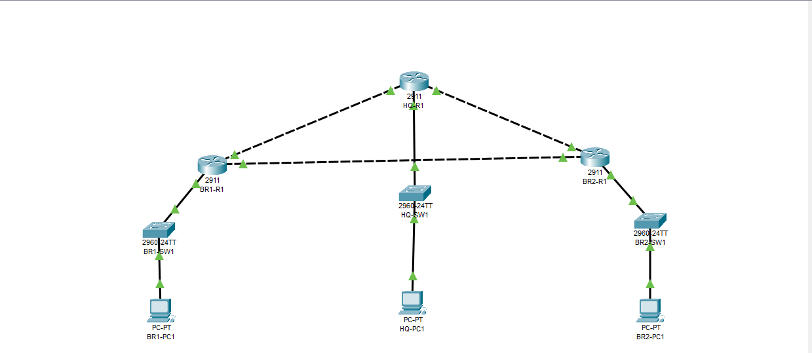
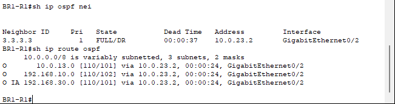
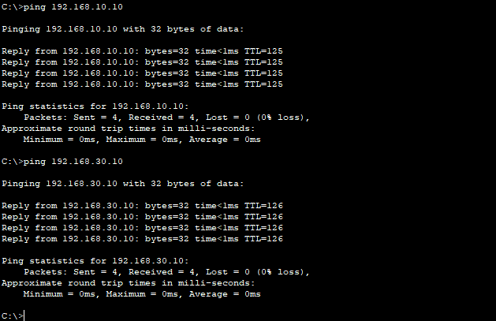
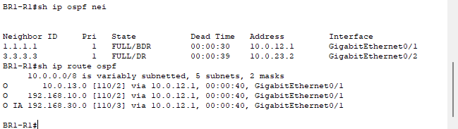

# Multisite OSPF Deployment and Failover Lab

## Overview

I built a three-site network in Cisco Packet Tracer to practice deploying OSPF, choosing a preferred WAN path, and verifying connectivity during a simulated link failure. I first tested a single-area design, then moved the branch LANs into separate OSPF areas and repeated the failover test.

This is a guided personal lab, completed by Michael Bessard in preparation for network engineering and cybersecurity roles.

## Skills demonstrated

- IPv4 addressing and subnetting using /24 LANs and /30 WAN links.
- Cisco router interface configuration and OSPF neighbor verification.
- Multi-area OSPF, Area Border Routers (ABRs), and inter-area routes.
- OSPF cost configuration to prefer the path through HQ.
- Controlled link failure, route verification, endpoint testing, and recovery.

## Topology

The lab uses three Cisco 2911 routers, three Cisco 2960 switches, and one PC per site. Each PC connects through its local switch to its router. HQ connects to both branches; a separate branch-to-branch link provides an alternate path.



| Site | Router ID | LAN | PC address | Default gateway | LAN OSPF area |
| --- | --- | --- | --- | --- | --- |
| HQ | 1.1.1.1 | 192.168.10.0/24 | 192.168.10.10 | 192.168.10.1 | 0 |
| BR1 | 2.2.2.2 | 192.168.20.0/24 | 192.168.20.10 | 192.168.20.1 | 10 |
| BR2 | 3.3.3.3 | 192.168.30.0/24 | 192.168.30.10 | 192.168.30.1 | 20 |

All LAN gateways use GigabitEthernet0/0. All WAN links remain in area 0.

| WAN link | First endpoint | Second endpoint | Subnet |
| --- | --- | --- | --- |
| HQ–BR1 | HQ G0/1: 10.0.12.1 | BR1 G0/1: 10.0.12.2 | 10.0.12.0/30 |
| HQ–BR2 | HQ G0/2: 10.0.13.1 | BR2 G0/1: 10.0.13.2 | 10.0.13.0/30 |
| BR1–BR2 backup | BR1 G0/2: 10.0.23.1 | BR2 G0/2: 10.0.23.2 | 10.0.23.0/30 |

## Routing design

OSPF process 1 runs on all routers. BR1 connects areas 0 and 10; BR2 connects areas 0 and 20. Both branches therefore act as ABRs. Each LAN interface is passive: its network is advertised, but the router does not send OSPF hellos toward the PCs.

The backup interface has `ip ospf cost 100` configured on both branches. With all links available, branch traffic prefers the lower-cost route through HQ. When BR1's direct HQ link is disabled, OSPF selects the branch-to-branch link.

The small topology could operate in one area. Multiple areas are used here to practice OSPF hierarchy. Areas organize topology information; they do not provide traffic filtering or security isolation.

## Verified failover results

I disabled BR1's GigabitEthernet0/1 interface to simulate loss of its direct WAN link to HQ, checked the new routes, tested PC connectivity, and restored the interface.

| State observed on BR1 | HQ LAN next hop / cost | BR2 LAN next hop / cost | Neighbors |
| --- | --- | --- | --- |
| Before failure | 10.0.12.1 / 2 | 10.0.12.1 / 3 | HQ and BR2 FULL |
| BR1–HQ link disabled | 10.0.23.2 / 102 | 10.0.23.2 / 101 | BR2 FULL |
| Direct link restored | 10.0.12.1 / 2 | 10.0.12.1 / 3 | HQ and BR2 FULL |

BR2's LAN remained an `O IA` (OSPF inter-area) route. HQ also displayed both branch LANs as `O IA` after the area changes.

During the outage, BR1-PC1 successfully pinged HQ-PC1 and BR2-PC1. Each displayed four packets sent, four received, and zero loss after convergence. These checks demonstrate connectivity after convergence; convergence time and packet loss at the instant of failure were not measured.

### Backup routes



### Endpoint connectivity during the outage



### Preferred path restored



## Repeat the test

1. Download [multisite-ospf-multiarea.pkt](multisite-ospf-multiarea.pkt) and open it in Cisco Packet Tracer. The lab was built using version 8.2.2.
2. On BR1-R1, verify the starting state:

   ```text
   show ip ospf neighbor
   show ip route ospf
   ```

3. Disable the direct HQ link on BR1-R1:

   ```text
   configure terminal
   interface gigabitEthernet0/1
   shutdown
   end
   ```

4. Allow OSPF to converge, then repeat the neighbor and route checks. The next hop for the remote LANs should change to 10.0.23.2.
5. From BR1-PC1's command prompt, test both destinations:

   ```text
   ping 192.168.10.10
   ping 192.168.30.10
   ```

6. Restore the link on BR1-R1:

   ```text
   configure terminal
   interface gigabitEthernet0/1
   no shutdown
   end
   ```

7. Allow the adjacency to return to FULL and verify that the preferred next hop returns to 10.0.12.1. Save the restored configuration with `copy running-config startup-config`, then save the Packet Tracer project.

## Troubleshooting observation

After moving BR1's LAN to area 10, HQ's `show ip route ospf` output displayed `O IA`, while `show ip route 192.168.20.0` still reported "type intra area." BR1's interface output confirmed area 10, and its OSPF configuration contained the intended area assignments. This conflicting output was recorded; its cause was not established.

## What I learned

I practiced checking neighbor state, route type, next hop, cost, and endpoint connectivity as separate parts of validation. A working adjacency alone does not prove that PCs can communicate. I also verified that OSPF returns to the preferred path after the failed link is restored.

## Scope

This project demonstrates simulated routing deployment and availability testing. Firewall policies, OSPF authentication, route summarization, and production performance testing were not part of this lab.
